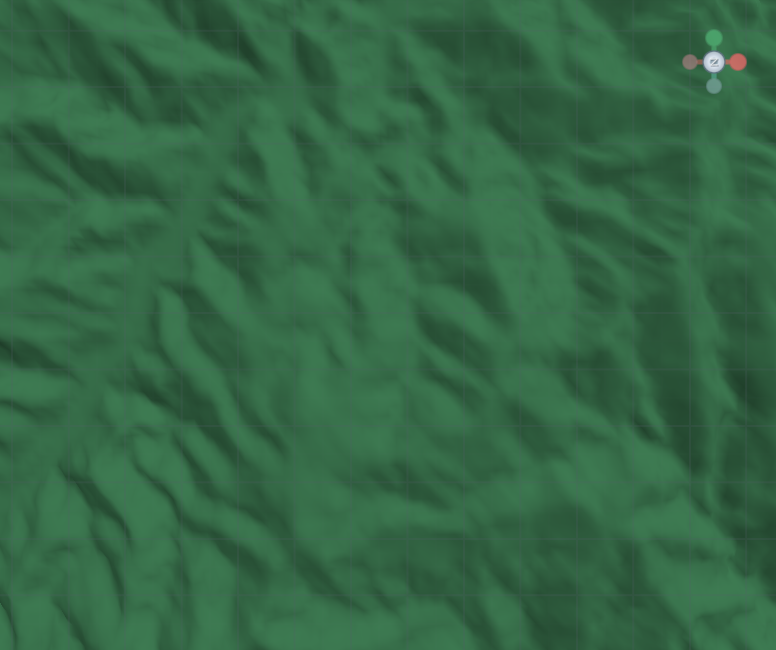
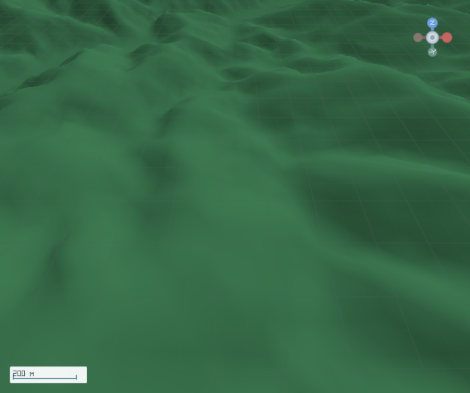

# M2-A1-R4 最终候选 RTX 3060 集成验收

日期：2026-10-22（Asia/Shanghai）

## 身份与环境

- 最终产品源码提交：`61988245638747bee4ee9fda9ebd4ccdc1b3197f`；Tree：`3a649a0e60f8238981754f88746ff5b358a49e2b`；分支：`codex/m2-a1-vuid-fix-20261022`，已推送到 `origin/渲染器2.0`。
- 产品版本：`v0.3.0.28-fix`。NASADEM `n24e121.hgt` SHA-256：`BEF65347232885016C50F73B9EBDC09D52B82FD5EB4517377220F7B8211340E1`.
- 构建来源 `HEAD=61988245638747bee4ee9fda9ebd4ccdc1b3197f; DIRTY=YES`。tracked source clean；候选 `.xye-workspace/` 未归档输出保留，因此没有伪报 clean。
- Windows；SDK 10.0.400；NVIDIA GeForce RTX 3060；驱动 32.0.16.1088（2026-07-22）；Vulkan API 1.4.341。
- `VK_LAYER_KHRONOS_validation` 通过 Vulkan Loader 日志确认已插入 Instance 与 Device。
- App.exe、UI.dll、CLI.exe、Vulkan.dll SHA-256 见 `binary-sha256.txt`。

## 实测矩阵

| 场景 | 结果 | 真实证据 |
| --- | --- | --- |
| maintenance1 扩展和 Feature | PASS | `VK_EXT_surface_maintenance1 enabled=true`；`VK_EXT_swapchain_maintenance1 enabled; swapchainMaintenance1 feature=true` |
| 多帧、不同 image index | PASS（覆盖 0 和 1） | generation 0 的 Present Fence 日志见 image=0 与 image=1；swapchain imageCount=3。未观察到 index 2，本轮 coverage 只确认两个不同 image。 |
| 连续真实 Resize | PASS | 隐藏 HWND SetWindowPos 使用 SWP_NOMOVE|SWP_NOZORDER|SWP_NOACTIVATE；776×650→1024×768→1180×820，runtime.info 实际 client size 均匹配，Visible=false、OwnProcessForeground=false。 |
| OutOfDate / Present 恢复 | PASS | 两次 `呈现过期：来源=队列呈现；进入自愈`，各自重建 generation 0→1、1→2，随后日志记录恢复呈现。 |
| 旧代资源安全退休 | PASS（Resize 路径） | generation 0、1 retirement 均记录 `graphics=complete; present=complete`，之后才创建新代；每代 imageCount=3。 |
| 多帧同步 Fence | PASS | Present Fence completion 日志含 generation、image、swapchain；关闭前 generation 2 image 0 完成记录。 |
| 第一帧后立即关闭 | PASS | RunId `m2a1-r4-stop-after-frame-61988245-20261022`；首个 runtime.info 已有 Frame 24，立即 `session.close` closed=true，CLI ExitCode 0。 |
| 正常关闭及重启 | PASS | Resize 会话关闭后，独立 RunId `m2a1-r4-restart-61988245-20261022` 再启动/Present/关闭，ExitCode 0。 |
| 最终候选 DEM GPU 像素读回 | PASS（两姿态） | `n24e121`, TerrainRevision=1；俯视 Frame 738 / CameraRevision 4 / ImageIndex 0 / Generation 0 / 776×650；斜视 Frame 740 / Revision 5 / ImageIndex 0 / Generation 0 / 776×650；两张原始 swapchain PNG 和 sidecar 随本报告归档。两 pose 的垂直 Surface Query 均 Valid。 |
| Vulkan Validation | PASS（本轮覆盖路径） | resize、读回、restart 与 immediate-close 进程均 ExitCode 0；每组日志 Validation Error/Warning/VUID=0，VUID-07987=0。 |
| CPU/GPU 性能统计 | UNKNOWN | 未采集 GPU timestamps/P95，本报告不推算。 |
| DeviceLost / unknown completion 注入 | NOT RUN | 未注入驱动故障或未知队列完成。 |

## 定向测试与门禁

- Release focused sync / generation / acquire / present-fence / resize / swapchain contract + #55 push-constant tests：55/55 PASS，0 failed，0 skipped；RunId `66c1d42bd98342e89ee5459eeaa8ee70`，Manifest `COMPLETED / 0`。命令保留 `--no-restore`，并因已知编译问题排除 `VulkanOffscreenDeviceTests.cs`。这不是 World.Tests 全量通过。
- 两项 `VulkanSwapchainChurnTests` 因 source helper 从 `AppContext.BaseDirectory` 推导仓库根、无法穿过候选 `--artifacts-path` 目录读取源码而失败；原始输出作为限制证据保留。相同两条静态合同对候选源码直接复核为 true。该两个 source-inspection 测试不计为 PASS，也没有改测试来掩盖路径限制。
- Arch-A 脚本退出码 1，唯一违规为既有 `XuanYu.Render.Abstractions.csproj → XuanYu.Render.Vulkan` ProjectReference；未修改该文件或 shared workspace。5+100 核对：本轮触及的 Vulkan Pipeline、VectorOverlay、合同测试文件物理行数分别为 99、48、30，均未超过 100；Arch-A 联合门禁仍 FAIL。
- 最终源码 SHA `61988245` 上全量 `xye-dotnet test XuanYu.World.Tests\\XuanYu.World.Tests.csproj --no-restore --configuration Release` 真实退出码 1；RunId `db5add7b3cd0415c8a31081b588d2111`，Manifest `FAILED / 1`。实际编译错误为 `VulkanOffscreenTerrainRenderer` 缺失（CS0246，VulkanOffscreenDeviceTests.cs:54）和 `Assert.Throws<T>(Func<Task>)` obsolete error（CS0619，同文件:57）；原始 stdout 已归档。

## GPU 图片与 SHA-256

俯视 PNG SHA-256：`76903809C7C2C107481831636714071F55D8C8F5812FA2C3921AB85A9180C0B9`。侧车记录 RunId、源码 SHA/Tree、TerrainId/Revision、CameraRevision、FrameId、ImageIndex、Generation、Extent。

斜视 PNG SHA-256：`6E8AE2E99E5283A159CD8AC74EC212AD1817DD58C767B295B63EA5D1075DF47F`。侧车与俯视图同一源码候选与 RunId；Frame 740、CameraRevision 5、ImageIndex 0、Generation 0、776×650。

全部原始协议、Validation/Vulkan、resize 代际、Fence、关闭/重启和定向测试日志均与图片一起归档；目录内 `SHA256SUMS.txt` 对每个归档文件校验。

## 最终裁定：DELIVERY PARTIAL / INTEGRATION PARTIAL

同一候选源码身份上完成了真实 RTX 3060 多帧 Present、两个 image index 覆盖、两次 OutOfDate 自愈/Resize/Swapchain generation 更替、Present Fence 完成后旧代退休、立即 Stop、正常 Close/Restart、两张最终候选 DEM GPU 读回以及 Validation-clean 本轮日志。候选当前 DIRTY=YES（只有未归档任务材料）；Arch-A 既有 Dirty ProjectReference 仍失败；全量 World.Tests 仍被已知编译问题阻断；DeviceLost/unknown completion 注入未运行；三个 swapchain image 中仅观察到 index 0 和 1。上述差距阻止升级为完整 Integration PASS。